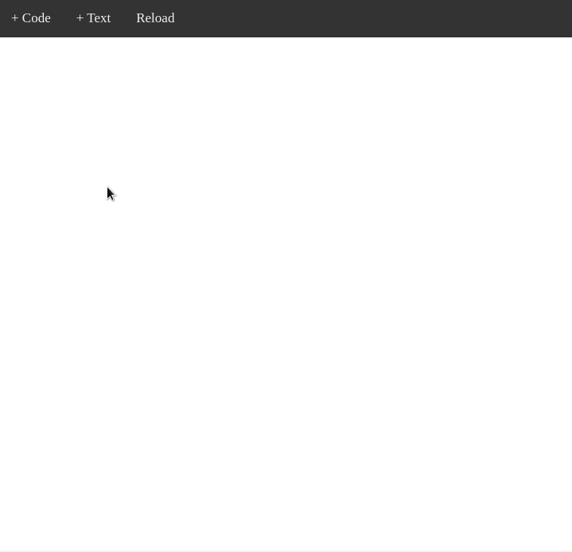
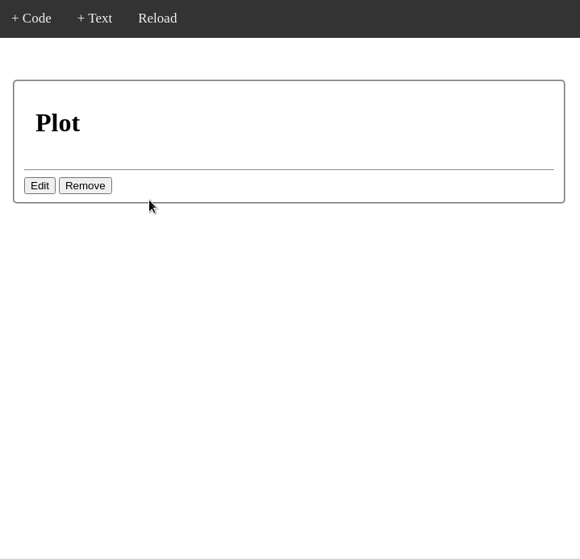

# Go-Notebook

Go-Notebook is an app that was developed using go-echo-live-view framework, developed also by us.

GitHub repository is [here](https://github.com/arturoeanton/go-echo-live-view).

For this project we using https://github.com/cosmos72/gomacro too

## About

Go-Notebook is inspired by Jupyter Project ([link](https://github.com/jupyter/notebook)) in order to document Golang code.

You can add code and text depends your needs.

## Features

* Modern UI with light/dark theme, CodeMirror editor with Go syntax highlighting, and keyboard shortcuts (run cells with `Shift+Enter`).
* Jupyter-style workflow: execution counter (`[n]`, `[*]` while running), Run all, Clear output per cell or for the whole notebook, move/insert/duplicate cells from the hover toolbar, and collapsible outputs.
* `ShowPlot(p)` works out of the box for gonum plots (host-side via reflection, no gonum dependency in the binary).
* Notebook manager sidebar: create, rename, duplicate and delete notebooks.
* Per-tab sessions: each browser tab gets its own notebook and interpreter.
* Cell outputs are persisted with the notebook and survive reloads; saving is automatic (debounced).
* Export any notebook as a standalone HTML page (`Export` button or `/export/<name>`).
* Headless, parameterized runs: `go-notebook run <name> -p key=value -o report.html` executes every cell and writes the HTML report — schedule it with cron for automated reporting.
* Variables panel (`Vars` button): live view of the interpreter's variables with name, type and value, refreshed after every cell run.
* Markdown cells rendered server-side.
* Bundled libraries, importable from any cell with **no network access or plugin compilation** (precompiled gomacro bindings in `bindings/`):
  * [go-pandas](https://github.com/arturoeanton/go-pandas) — DataFrames for Go (`import pd "github.com/arturoeanton/go-pandas"`)
  * [go-dsl](https://github.com/arturoeanton/go-dsl) — build small languages (`import "github.com/arturoeanton/go-dsl/pkg/dslbuilder"`)
  * [go-xml](https://github.com/arturoeanton/go-xml) — XML parsing and queries (`import gx "github.com/arturoeanton/go-xml/xml"`)
* Interactive data grid: `ShowGrid(df)` renders a live, server-side grid with sorting, filtering and pagination — only the visible page travels to the browser.
* SQL built in: `ReadSQL(driver, dsn, query)` returns a go-pandas DataFrame and `SQLExec` runs statements, with **sqlite** (no cgo) and **postgres** drivers compiled into the binary.
* Native SVG charts with hover tooltips: `BarChart`, `LineChart`, `AreaChart`, `ScatterChart`, `Histogram`, `PieChart` — no plotting engine to compile.
* Helpers available in every cell (defined in `default.gonote`): `ShowDF(df)` renders a DataFrame as an HTML table, `ShowHTML(s)` renders raw HTML, `ColF`/`ColS` pull DataFrame columns as slices.
* Other third-party packages can still be imported at runtime through gomacro module imports (requires the Go toolchain and network).
* The default notebook demos the bundled libraries and runs instantly. The `gonum` notebook (pick it from the toolbar) demos gonum/plot: its first run downloads and compiles the package on the fly, which can take a minute or two.

## Multi-user mode

Authentication is off by default (open mode, for local use). Enable it by
creating users:

```
go run . user add ana            # prompts for a password
go run . user list
go run . user del ana
```

With at least one user in `users.json`, the server requires signing in and
gives **each user their own workspace** (`workspaces/<user>/`), seeded with
the default notebook on first login. Passwords are stored as bcrypt hashes
and sessions use HMAC-signed cookies. `users.json` and `workspaces/` are
gitignored.

## Security

Notebook cells run **arbitrary Go code with the server's privileges** — that
is the point of the tool, and also the reason to be careful:

* The server listens on `localhost:1323` by default. To expose it use
  `-p 0.0.0.0:1323`, enable authentication, and put it behind TLS.
* Authentication controls *who gets in*, not *what code can do*: any signed-in
  user can read files, open network connections and consume resources on the
  host. Only give accounts to people you would give shell access to.
* For anything beyond a trusted team, run one instance per trust boundary in
  the provided Docker container (it drops to a non-root user).

## Requirements

Go 1.25.5 or newer.

## Run

```
git clone https://github.com/arturoeanton/go-notebook.git
cd go-notebook
go run .
```

#### Wait
```
⇨ http server started on [::]:1323
```

### Go to
http://localhost:1323/

## Run on docker

```
docker pull arturoeanton/go-notebook
docker run --rm -p 1323:1323 arturoeanton/go-notebook
```
### Go to
http://localhost:1323/


### Change notebooks and snippet folders

#### Docker

```
docker run --rm -p 1323:1323 --volume ./notebooks:/app/notebooks --volume ./snippet:/app/snippet arturoeanton/go-notebook
```

#### Podman

```
podman run   --rm -p 1323:1323 --volume ./notebooks:/app/notebooks:Z --volume ./snippet:/app/snippet:Z arturoeanton/go-notebook
```

## Regenerating the bundled bindings

The files in `bindings/` are generated with the gomacro CLI (mode `_3`) and
registered at startup through `imports.Packages.Merge`. To update them after
bumping a library version:

```
go install github.com/cosmos72/gomacro@latest
echo 'import _3 "github.com/arturoeanton/go-pandas"' | GODEBUG=gotypesalias=0 gomacro
```

then copy the generated file from `$GOPATH/src/github.com/cosmos72/gomacro/imports/thirdparty/`
into `bindings/`, changing the package clause to `bindings`.

## DEMO






## To Do

This project is still in progress, we are working in the following features.
 * Add examples.
 * Save snippet
 * default.gonote.json convert in folder, and run files in this folder.

## Contributing
Pull requests are welcome. For major changes, please open an issue first to discuss what you would like to change.

## License
[MIT](https://choosealicense.com/licenses/mit/)
